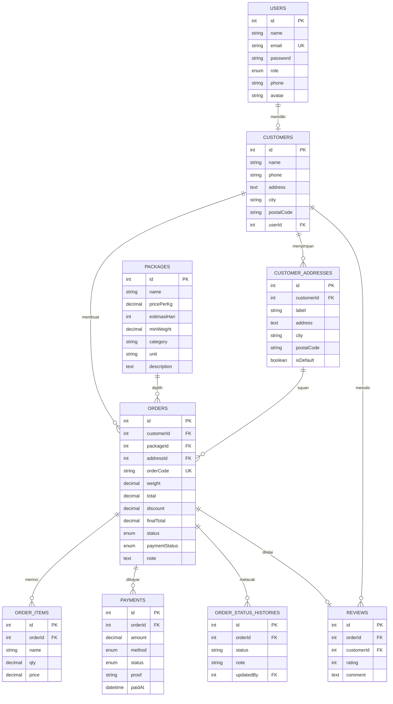

# Laundry Revina

Aplikasi laundry online Laundry Revina dengan alur customer untuk daftar, mengelola alamat, memesan, membayar, dan melacak pakaian; panel admin/kasir tetap tersedia. Dibangun dengan React, Vite, Express, Sequelize, MySQL, dan JWT. Semua antarmuka serta pesan API menggunakan Bahasa Indonesia.

## BAGIAN 1: Analisis Teknologi

React dipilih karena cocok untuk dashboard operasional berbasis komponen, ekosistemnya matang, dan mudah dipadukan dengan Vite. Vue lebih ringan untuk tim yang mengutamakan kurva belajar singkat; Angular menyediakan struktur enterprise lengkap tetapi lebih berat untuk aplikasi ini. Express memberi API REST minimal dan fleksibel, Sequelize mengelola relasi MySQL, sedangkan React Router dan Axios menangani navigasi serta komunikasi API.

| Pilihan | Kelebihan | Pertimbangan |
| --- | --- | --- |
| React (dipakai) | Ekosistem luas, komponen fleksibel, Vite cepat | Perlu memilih pustaka pendukung |
| Vue | Sintaks ringkas, mudah dipelajari | Ekosistem dan pola kerja berbeda dari stack yang diminta |
| Angular | Struktur dan dependency injection terintegrasi | Ukuran dan kompleksitas lebih besar untuk kebutuhan ini |

## BAGIAN 2: PRD, ERD, Userflow, dan Paket

### PRD

Laundry Revina membantu customer memesan layanan antar-jemput, memilih add-on, mengelola beberapa alamat, membayar, dan memantau riwayat tujuh tahap. Admin/kasir mengelola pelanggan, paket, status, dan verifikasi pembayaran.

### ERD



### Alur Pengguna

1. Customer mendaftar dengan nama, email, telepon, dan kata sandi; satu profil pelanggan dibuat otomatis.
2. Customer menyimpan alamat rumah/kantor, memilih jadwal dan metode jemput, paket, serta add-on.
3. Server menghitung berat, diskon 20% pesanan pertama, biaya jemput, dan total final; order mendapat kode LRV.
4. Customer mengirim pembayaran dan bukti transfer bila diperlukan; kasir/admin memverifikasi.
5. Order bergerak melalui pending, confirmed, picked_up, washing, ironing, ready, dan delivered; tahap dicatat pada riwayat.
6. Customer melihat detail/timeline dari dashboard, riwayat, atau halaman Lacak publik menggunakan kode order.

### Paket Seed

| Nama | Harga | Estimasi | Deskripsi |
| --- | ---: | ---: | --- |
| Cuci Kering | Rp 5.000/kg | 3 hari | Cuci bersih, kering, dan siap dilipat |
| Cuci Setrika | Rp 7.000/kg | 3 hari | Cucian bersih dan disetrika rapi |
| Setrika Saja | Rp 4.000/kg | 2 hari | Pakaian disetrika hingga licin |
| Paket Hemat | Rp 5.500/kg | 4 hari | Minimal 5 kg |
| Express 24 Jam | Rp 12.000/kg | 1 hari | Selesai dalam 24 jam |
| Super Express 6 Jam | Rp 18.000/kg | 6 jam | Prioritas pengerjaan |
| Premium (Parfum) | Rp 15.000/kg | 2 hari | Parfum pilihan |
| Cuci Sepatu | Rp 35.000/pasang | 2 hari | Deep clean |
| Cuci Karpet | Rp 25.000/m² | 3 hari | Cuci menyeluruh |
| Cuci Bed Cover | Rp 20.000/kg | 3 hari | Bed cover bersih dan segar |

Layanan tambahan: Setrika Extra Rp 3.000/kg, Parfum Premium Rp 5.000, Cuci Bersih Noda Rp 8.000, Express Handling Rp 10.000, Antar Jemput Rp 5.000 (gratis untuk pesanan minimal Rp 50.000).

## BAGIAN 3: Setup Terminal dari Nol

Jika benar-benar membuat folder baru dari direktori induk, siapkan folder dan manifest awal:

```powershell
mkdir app-laudry
cd app-laudry
mkdir backend, frontend
cd backend
npm init -y
cd ..\frontend
npm init -y
```

Salin struktur dan isi file proyek ini setelah `npm init -y`, karena `package.json` final aplikasi perlu dipertahankan. Untuk instalasi workspace ini yang sudah berisi kode, jangan jalankan `npm init` lagi.

Backend memakai Node.js 18 atau lebih baru dan MySQL 8. Frontend memakai Node.js 18 atau lebih baru. Instal paket dari masing-masing direktori:

```powershell
cd C:\Users\LENOVO\app-laudry\backend
npm install
```

Paket backend mencakup Express, Sequelize, mysql2, jsonwebtoken, bcryptjs, multer, cors, helmet, morgan, dotenv, nodemon, dan sequelize-cli. Jika membuat proyek kosong secara manual:

```powershell
npm install express sequelize mysql2 jsonwebtoken bcryptjs multer cors helmet morgan dotenv express-validator
npm install -D nodemon sequelize-cli
```

```powershell
cd C:\Users\LENOVO\app-laudry\frontend
npm install
```

Paket frontend mencakup React, Vite, TailwindCSS, React Router DOM, Axios, Lucide icons, dan qrcode.react.

## BAGIAN 4: File Backend Lengkap

Kode backend ada di `backend/src`: `app.js`, `server.js`, konfigurasi database, controller auth/user/package/customer/order/payment/dashboard, middleware auth/role/async handler, model dan asosiasi Sequelize, routes, migrations, serta seeder paket dan admin. Konfigurasi CLI ada pada `backend/.sequelizerc`.

Endpoint tersedia:

| Metode | Endpoint | Akses |
| --- | --- | --- |
| POST | `/api/auth/register` | Publik, selalu membuat role customer |
| POST | `/api/auth/login` | Publik |
| GET | `/api/auth/me` | JWT |
| GET | `/api/packages`, `/api/packages/:id`, `/api/packages/add-ons` | Publik |
| POST, PUT, DELETE | `/api/packages` | JWT admin |
| GET, POST, PUT, DELETE | `/api/customers` | JWT; perubahan admin/kasir |
| GET, POST, PUT, DELETE, PATCH | `/api/addresses` | JWT customer, hanya alamat milik akun aktif |
| POST | `/api/orders/customer` | JWT customer |
| GET | `/api/orders/my-orders`, `/api/orders/my-orders/:id` | JWT customer, hanya order sendiri |
| PATCH | `/api/orders/:id/cancel` | Pemilik order, hanya sebelum konfirmasi |
| GET | `/api/orders/track/:code` | Publik, kode order atau ID lama |
| GET, POST | `/api/payments`, `/api/payments/my-payments` | JWT, data customer dibatasi ke order sendiri |
| POST | `/api/payments/:id/upload` | JWT, bukti JPG/PNG/WEBP maks. 5 MB |
| PATCH | `/api/payments/:id/status` | JWT admin/kasir |
| PUT | `/api/users/me`, `/api/users/me/password` | JWT akun aktif |
| GET, POST, PUT, DELETE | `/api/users` | Admin |
| GET | `/api/dashboard/customer-stats`, `/api/dashboard/my-orders` | JWT customer |
| GET | `/api/dashboard/stats` | JWT admin/kasir |

Pendaftaran publik sengaja tidak menerima role admin untuk mencegah eskalasi hak akses. Akun admin dibuat aman oleh seeder.

## BAGIAN 5: File Frontend Lengkap

Kode frontend ada di `frontend/src`: bootstrap React, context autentikasi, Axios interceptor, komponen StatusBadge/Timeline, landing page, dashboard customer, wizard order, riwayat/detail, profil, alamat, pembayaran, tracking, dan panel staf. Jalur customer: `/`, `/login`, `/register`, `/dashboard`, `/create-order`, `/my-orders`, `/my-orders/:id`, `/packages`, `/profile`, `/address`, `/payment/:id`, dan `/track`.

Token JWT tersimpan pada `localStorage` dengan kunci `revina_token`; data pengguna memakai `revina_user`. Untuk alamat API selain `http://localhost:3000/api`, buat `frontend/.env` berisi `VITE_API_URL=http://alamat-api/api` lalu jalankan ulang Vite.

## BAGIAN 6: Database, Migrate, dan Seed

`backend/.env` menggunakan konfigurasi lokal berikut. Sesuaikan DB_USER/DB_PASS dengan instalasi MySQL:

```dotenv
PORT=3000
DB_HOST=127.0.0.1
DB_PORT=3306
DB_NAME=laundry_revina
DB_USER=root
DB_PASS=
JWT_SECRET=revina_super_secret_key_2025
JWT_EXPIRES=1d
FRONTEND_URL=http://localhost:5173
```

Buat database melalui terminal MySQL:

```powershell
mysql -u root -p -e "CREATE DATABASE laundry_revina CHARACTER SET utf8mb4 COLLATE utf8mb4_unicode_ci;"
```

Atau buka phpMyAdmin, pilih **Baru**, isi nama `laundry_revina`, pilih collation `utf8mb4_unicode_ci`, lalu tekan **Buat**. Pastikan MySQL berjalan sebelum migrasi.

Migrasikan tabel, lalu jalankan seluruh seeder:

```powershell
cd C:\Users\LENOVO\app-laudry\backend
npx sequelize-cli db:migrate
npx sequelize-cli db:seed:all
```

Seeder membuat 10 paket, 5 add-on, akun admin `admin@revina.com` / `admin123`, kasir `kasir@revina.com` / `kasir123`, customer `customer@revina.com` / `customer123`, dua alamat customer, dan tiga order demo. Ganti semua kata sandi bawaan sebelum penggunaan nyata.

## BAGIAN 7: Jalankan Backend dan Frontend

Buka terminal pertama:

```powershell
cd C:\Users\LENOVO\app-laudry\backend
npm run dev
```

Buka terminal kedua:

```powershell
cd C:\Users\LENOVO\app-laudry\frontend
npm run dev
```

Frontend tersedia di `http://localhost:5173`, API di `http://localhost:3000`. Migrasi/seeder dijalankan sekali sebelum server pertama. Login admin awal: `admin@revina.com` / `admin123`.

## BAGIAN 8: Pengujian API dengan curl

Contoh berikut memakai PowerShell dan `curl.exe`. Register publik membuat akun customer; admin uji masuk memakai akun admin hasil seed.

Daftar customer:

```powershell
$registerBody = @{ name = 'Pelanggan Uji'; email = 'uji@example.com'; phone = '081234567890'; password = 'pelanggan123' } | ConvertTo-Json -Compress
curl.exe -X POST http://localhost:3000/api/auth/register -H "Content-Type: application/json" --data-binary $registerBody
```

Login admin seed dan siapkan token:

```powershell
$loginBody = @{ email = 'admin@revina.com'; password = 'admin123' } | ConvertTo-Json -Compress
$session = curl.exe -s -X POST http://localhost:3000/api/auth/login -H "Content-Type: application/json" --data-binary $loginBody | ConvertFrom-Json
$token = $session.token
$authHeader = "Authorization: Bearer $token"
```

Buat customer:

```powershell
$customerBody = @{ name = 'Sari Anggraini'; phone = '081234567890'; address = 'Jl. Melati No. 12' } | ConvertTo-Json -Compress
$customer = curl.exe -s -X POST http://localhost:3000/api/customers -H "Content-Type: application/json" -H $authHeader --data-binary $customerBody | ConvertFrom-Json
```

Buat order Reguler:

```powershell
$packages = curl.exe -s http://localhost:3000/api/packages -H $authHeader | ConvertFrom-Json
$regular = $packages | Where-Object name -eq 'Cuci Kering' | Select-Object -First 1
$orderBody = @{ customerId = $customer.id; packageId = $regular.id; weight = 3.5; note = 'Pisahkan pakaian putih' } | ConvertTo-Json -Compress
$order = curl.exe -s -X POST http://localhost:3000/api/orders -H "Content-Type: application/json" -H $authHeader --data-binary $orderBody | ConvertFrom-Json
```

Perbarui status order dan coba pelacakan publik:

```powershell
$statusBody = @{ status = 'confirmed' } | ConvertTo-Json -Compress
curl.exe -X PATCH "http://localhost:3000/api/orders/$($order.order.id)/status" -H "Content-Type: application/json" -H $authHeader --data-binary $statusBody
curl.exe "http://localhost:3000/api/orders/track/$($order.order.id)"
```

Contoh pesanan dari akun customer demo. Endpoint ini memakai alamat customer yang dibuat oleh seeder, lalu server mengembalikan `orderCode`, total, dan estimasi:

```powershell
$customerLogin = @{ email = 'customer@revina.com'; password = 'customer123' } | ConvertTo-Json -Compress
$customerSession = curl.exe -s -X POST http://localhost:3000/api/auth/login -H "Content-Type: application/json" --data-binary $customerLogin | ConvertFrom-Json
$customerHeader = "Authorization: Bearer $($customerSession.token)"
$address = curl.exe -s http://localhost:3000/api/addresses -H $customerHeader | ConvertFrom-Json | Select-Object -First 1
$catalog = curl.exe -s http://localhost:3000/api/packages | ConvertFrom-Json
$service = $catalog | Where-Object name -eq 'Cuci Kering' | Select-Object -First 1
$pickup = (Get-Date).AddHours(2).ToString('yyyy-MM-ddTHH:mm:ss')
$customerOrderBody = @{ addressId = $address.id; packageId = $service.id; weight = 2; pickupMethod = 'pickup'; pickupSchedule = $pickup; note = 'Mohon hubungi saat tiba'; addOns = @() } | ConvertTo-Json -Compress
$customerOrder = curl.exe -s -X POST http://localhost:3000/api/orders/customer -H "Content-Type: application/json" -H $customerHeader --data-binary $customerOrderBody | ConvertFrom-Json
curl.exe "http://localhost:3000/api/orders/track/$($customerOrder.orderCode)"
```
Untuk membuat akun admin tambahan, login sebagai admin lalu gunakan `POST /api/users` dengan properti name, email, password, dan role `admin`; endpoint register publik tidak menerima role admin.

## BAGIAN 9: Troubleshooting

| Pesan | Penyebab dan solusi |
| --- | --- |
| `Unknown database 'database_development'` | Pastikan `.sequelizerc` memakai `src/config/database.js`, `DB_NAME=laundry_revina`, dan file `.env` berada di `backend`. Buat database `laundry_revina`, jangan memakai nilai konfigurasi default Sequelize. |
| `Cannot find config/config.json` | Jalankan `npx sequelize-cli` dari direktori `backend`. `.sequelizerc` proyek menunjuk konfigurasi ke `src/config/database.js`; jangan menjalankan CLI dari root. |
| `Missing script: dev` | Pastikan terminal berada di direktori yang tepat (`backend` atau `frontend`) lalu jalankan `npm install`. Backend menjalankan `npm run dev`; frontend juga memiliki skrip `dev`. |
| `npm error ENOENT package.json` | `cd` dahulu ke `backend` atau `frontend` sebelum menjalankan `npm install`, `npm run`, atau `npm init`. Periksa lokasi dengan `Get-Location` dan `Get-ChildItem package.json`. |
| `ECONNREFUSED 127.0.0.1:3306` | Jalankan layanan MySQL/XAMPP, periksa port `DB_PORT`, lalu pastikan kredensial `.env` benar. |
| `401` pada API | Login kembali; interceptor akan menghapus token kedaluwarsa dan mengarahkan browser ke halaman masuk. Masa berlaku token satu hari. |
| `403` pada perubahan paket/pengguna | Masuk dengan peran admin. Role tidak dapat dinaikkan melalui pendaftaran publik. |

## BAGIAN 10: Pengembangan Lanjutan

- **Cetak nota PDF:** tambahkan template nota berisi nomor order, pelanggan, rincian paket, berat, total, status pembayaran, dan tanggal estimasi; sediakan endpoint unduh yang memerlukan JWT.
- **Notifikasi WhatsApp:** hubungkan provider resmi WhatsApp Business, simpan kredensial di environment server, dan kirim notifikasi saat status order berubah. Jangan menaruh token provider di frontend.
- **Laporan harian:** tambahkan endpoint terfilter tanggal untuk jumlah order, pendapatan delivered, pembayaran masuk, dan transaksi belum lunas; tampilkan tabel ekspor CSV/PDF pada halaman laporan.